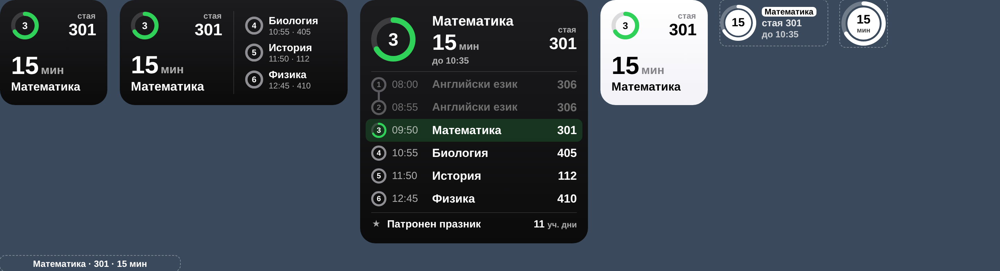

# School Widget

**Уиджет с училищната програма за iPhone:** кой час е сега, колко остава, в коя стая е следващият, кога е ваканцията. Работи в безплатното приложение [Scriptable](https://apps.apple.com/app/scriptable/id1405459188).

*[English below](#school-widget-english).*

- **Малък и среден:** часът сега (или следващият), колко минути остават, стаята.
- **Голям:** целият ден, а отдолу следващата ваканция и колко учебни дни остават до нея.
- **Заключен екран:** кръгъл, правоъгълен и на един ред.
- **Докосни уиджета:** днес, седмицата, почивните дни, настройките.

## Инсталиране (2 минути)

1. Инсталирай **[Scriptable](https://apps.apple.com/app/scriptable/id1405459188)** от App Store и го отвори веднъж.
2. Отвори **[страницата за инсталиране](https://batvani.github.io/school-widget/install/)** → **Добави прекия път** → **Пусни го**. Той изтегля School Widget и го отваря. (Не става? Там има и скрипт за инсталиране, и начин на ръка.)
3. School Widget пита за **програмата ти** (виж по-долу) → **Запази** → показва как се добавя уиджетът.

Нищо повече: School Widget се обновява сам.

## Програмата

- **С AI** (ChatGPT, Gemini, Claude…): в School Widget **Направи я с AI** копира промпта. Постави го в AI-а заедно със снимка на програмата, отговори на въпросите му, после **копирай целия му отговор** → School Widget → **Постави**.
- **От съученик:** отвори линка или снимай QR кода → **Отвори в School Widget**. Файл: **Внеси програма** → **От файл**.
- **На ръка:** **Въведи я на ръка**. Промяна по всяко време: **Програма** → **Промени програмата**.

Програмата остава на телефона. Важните (червени) часове и групата ти са само твои: не се споделят.

## Ваканциите

Официалните ваканции и почивни дни (и матурите, НВО) School Widget изтегля сам, за твоя клас. Ако се променят, промяната идва сама.

Искаш ги и в календара си (Apple, Google, Outlook)? **Почивни** → **Добави ваканциите в календара си**. Това е абонамент: обновява се сам и минава в следващия клас всеки септември. **Настройки → Град** (по желание) добавя дните, които градът ти обявява сам.

## Сподели с класа

**Програма** → **Сподели програмата** → линк, QR код или файл. Една снимка и един AI чат стигат за целия клас: споделя се с двете групи, всеки избира своята.

## Нова учебна година

От 1 септември в **Програма** има карта **Нова учебна година**: копирай промпта с твоите имена, дай го на AI с новата снимка и внеси новата програма. Кратките ти имена, важните часове и групата се запазват.

## Обновяване и поверителност

- Веднъж на ден School Widget проверява за нова версия и се обновява сам. Новата версия се проверява, преди да замени старата. Ако не тръгне, старата се връща сама. Програмата и настройките не се пипат. Всичко е в **Настройки → Версия**.
- School Widget се свързва само с GitHub: за нова версия и за почивните дни. Нищо не се изпраща.

## Ако нещо не работи

- **Прекият път не намира папката на Scriptable:** отвори Scriptable веднъж и опитай пак. Иначе: Settings → [името ти] → iCloud → включи **Scriptable**.
- **„Скриптът се казва …“:** преименувай го на **School Widget** (в Scriptable задръж върху него → Rename). Линковете търсят това име.
- **Линкът е отрязан:** копирай целия отговор на AI-а → **Внеси програма** → **Постави**.
- **Уиджетът не се променя:** iOS обновява уиджетите, когато реши. Задръж → **Edit Widget** → избери скрипта пак.
- **Странни знаци вместо кирилица:** кодът е копиран с грешно кодиране. Инсталирай го пак от страницата за инсталиране.

**Още:** [всички настройки](docs/SETTINGS.md) · [разработка](CONTRIBUTING.md) · проблем или идея: [Issues](https://github.com/batvani/school-widget/issues).

---

# School Widget (English)

**A school timetable widget for iPhone:** the class now, the time left, the next room, the next break. It runs in the free app [Scriptable](https://apps.apple.com/app/scriptable/id1405459188). Its text is Bulgarian by default; English is one setting away.

- **Small and medium:** the class now (or next), the minutes left, the room.
- **Large:** the whole day, and below it the next holiday with the school days left until it.
- **Lock Screen:** round, rectangular and one-line.
- **Tap the widget:** today, the week, the days off, settings.

## Install (2 minutes)

1. Install **[Scriptable](https://apps.apple.com/app/scriptable/id1405459188)** from the App Store and open it once.
2. Open the **[install page](https://batvani.github.io/school-widget/install/?lang=en)** → **Add the Shortcut** → **Run it**. It downloads School Widget and opens it. (Doesn't work? The page also has an install script and a way by hand.)
3. School Widget asks for **your timetable** (see below) → **Save** → it shows how to add the widget.

That's all: School Widget updates itself.

## Your timetable

- **With an AI** (ChatGPT, Gemini, Claude…): in School Widget, **Make it with an AI** copies the prompt. Paste it into the AI with a photo of your timetable, answer its questions, then **copy its whole answer** → School Widget → **Paste**.
- **From a classmate:** open the link or scan the QR code → **Open in School Widget**. A file: **Import a timetable** → **From a file**.
- **By hand:** **Type it in**. To change it any time: **Timetable** → **Edit the timetable**.

The timetable stays on the phone. Your important (red) classes and your group are yours: they aren't shared.

## Holidays

School Widget downloads the official holidays and days off (and the national exams) for your grade by itself. If they change, the change comes by itself.

Want them in your calendar too (Apple, Google, Outlook)? **Days off** → **Add the holidays to your calendar**. It's a subscription: it updates itself and moves on to the next grade every September. **Settings → City** (optional) adds the days your city declares itself.

## Share with your class

**Timetable** → **Share the timetable** → a link, a QR code or a file. One photo and one AI chat are enough for the whole class: it's shared with both groups, and everyone picks theirs.

## A new school year

From 1 September, **Timetable** has a **New school year** card: copy the prompt with your names, give it to an AI with the new photo, and import the new timetable. Your short names, important classes and group are kept.

## Updates and privacy

- Once a day School Widget checks for a new version and updates itself. A new version is checked before it replaces the old one, and if it doesn't start, the old one comes back by itself. Your timetable and settings aren't touched. It's all in **Settings → Version**.
- School Widget only connects to GitHub: for new versions and the days off. Nothing is sent.

## Troubleshooting

- **The Shortcut can't find Scriptable's folder:** open Scriptable once and try again. Otherwise: Settings → [your name] → iCloud → turn on **Scriptable**.
- **"This script is called …":** rename it to **School Widget** (in Scriptable, hold it → Rename). Links look for that name.
- **The link got cut off:** copy the AI's whole answer → **Import a timetable** → **Paste**.
- **The widget doesn't change:** iOS refreshes widgets when it decides. Hold it → **Edit Widget** → pick the script again.
- **Odd characters instead of Cyrillic:** the code was copied with the wrong encoding. Install it again from the install page.

**More:** [all settings](docs/SETTINGS.md) · [development](CONTRIBUTING.md) · problems or ideas: [Issues](https://github.com/batvani/school-widget/issues).

License: [MIT](LICENSE).
