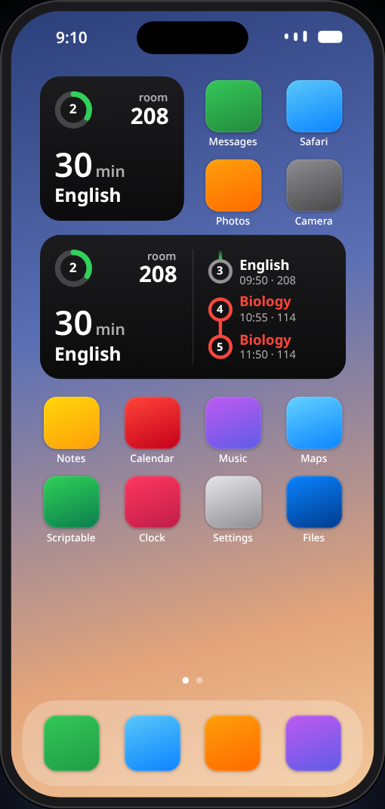
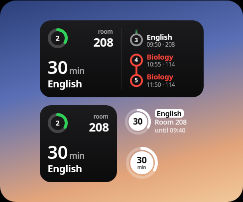
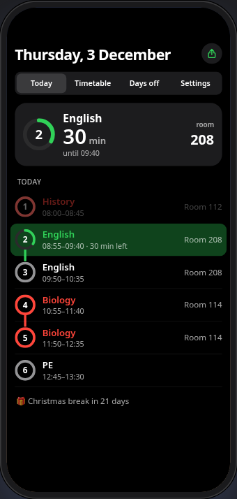
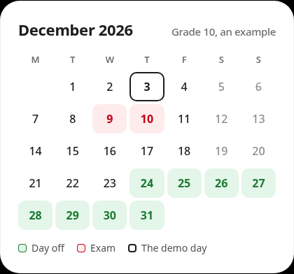
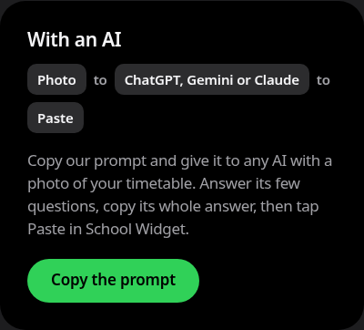

# School Widget

**Your school day, on your Home Screen.**

▶ **Try it live: [batvani.github.io/school-widget](https://batvani.github.io/school-widget/)** · [На български](#school-widget-на-български)

School Widget is a free iPhone widget for your timetable. It shows the class you are in, the minutes left, the next room and the days to the holidays. It runs in the free app [Scriptable](https://apps.apple.com/app/scriptable/id1405459188). Its text is Bulgarian by default; English is one setting.

<table>
<tr>
<td width="50%" valign="top"> <b>A widget for every spot</b> Small, medium, large and three Lock Screen shapes. All show the same day, each in the way that suits its space.</td>
<td width="50%" valign="top"> <b>Tap it for the whole picture</b> Today, the week, the days off and settings, full screen.</td>
</tr>
<tr>
<td valign="top"> <b>Every day off, in your calendar too</b> The official holidays and exams for your grade, as a subscription for Apple, Google or Outlook Calendar.</td>
<td valign="top"> <b>Your timetable, in a minute</b> With an AI, from a classmate's link or QR code, or by hand.</td>
</tr>
</table>

## Install in 2 minutes

1. Install **[Scriptable](https://apps.apple.com/app/scriptable/id1405459188)** from the App Store and open it once.
2. Open the **[install page](https://batvani.github.io/school-widget/#install)** → **Add the Shortcut** → **Run it**. It downloads School Widget and opens it. (If that fails, the page also has an install script and a way by hand.)
3. School Widget asks for **your timetable** (below) → **Save** → it shows how to add the widget.

School Widget then updates itself.

## Your timetable

| Way | How |
|---|---|
| **With an AI** (ChatGPT, Gemini, Claude…) | **Make it with an AI** copies the prompt. Paste it into the AI with a photo of your timetable, answer its questions, **copy its whole answer** → School Widget → **Paste**. |
| **From a classmate** | Open their link or scan their QR code → **Open in School Widget**. A file: **Import a timetable** → **From a file**. |
| **By hand** | **Type it in**. Change it any time: **Timetable** → **Edit the timetable**. |

The timetable stays on the phone. Your important (red) classes and your group are yours: they are never shared.

<b>Holidays and your calendar</b>

School Widget downloads the official holidays, days off and national exams for your grade by itself. If they change, the change comes by itself.

Want them in your calendar too (Apple, Google, Outlook)? **Days off** → **Add the holidays to your calendar**. It is a subscription: it updates itself and moves up a grade every September. **Settings → City** (optional) adds the days your city declares itself.

<b>Share with your class</b>

**Timetable** → **Share the timetable** → a link, a QR code or a file. One photo and one AI chat are enough for the whole class: it is shared with both groups, and everyone picks theirs.

<b>A new school year</b>

From 1 September, **Timetable** has a **New school year** card. Copy the prompt with your names, give it to an AI with the new photo, and import the new timetable. Your short names, important classes and group are kept.

<b>Updates and privacy</b>

- Once a day School Widget checks for a new version and updates itself. A new version is checked before it replaces the old one; if it does not start, the old one comes back by itself. Your timetable and settings are not touched. See **Settings → Version**.
- School Widget only connects to GitHub, for new versions and the days off. Nothing about you is sent.

<b>Troubleshooting</b>

| Problem | What to do |
|---|---|
| The Shortcut can't find Scriptable's folder | Open Scriptable once and try again. Otherwise: Settings → [your name] → iCloud → turn on **Scriptable**. |
| "This script is called …" | Rename it to **School Widget** (in Scriptable, hold it → Rename). Links look for that name. |
| The link got cut off | Copy the AI's whole answer → **Import a timetable** → **Paste**. |
| The widget doesn't change | iOS refreshes widgets when it decides. Hold it → **Edit Widget** → pick the script again. |
| Odd characters instead of Cyrillic | The code was copied with the wrong encoding. Install it again from the install page. |

**More:** [all settings](docs/SETTINGS.md) · [development](CONTRIBUTING.md) · problems or ideas: [Issues](https://github.com/batvani/school-widget/issues) · [MIT](LICENSE)

---

# School Widget (на български)

**Училищният ти ден, на началния екран.**

[English](#school-widget)

School Widget е безплатен уиджет за iPhone с училищната програма: кой час е сега, колко остава, в коя стая е следващият, кога е ваканцията. Работи в безплатното приложение [Scriptable](https://apps.apple.com/app/scriptable/id1405459188).

| | |
|---|---|
| **Уиджет за всяко място** | Малък, среден, голям и три вида за заключения екран. Всички показват един и същ ден, всеки по начин, който пасва на мястото му. |
| **Докосни го за цялата картина** | Днес, седмицата, почивните дни и настройките, на цял екран. |
| **Всеки почивен ден и в календара ти** | Официалните ваканции и матури за твоя клас, като абонамент за Apple, Google или Outlook Календар. |
| **Програмата ти за минута** | С AI, от линк или QR код на съученик, или на ръка. |

## Инсталиране (2 минути)

1. Инсталирай **[Scriptable](https://apps.apple.com/app/scriptable/id1405459188)** от App Store и го отвори веднъж.
2. Отвори **[страницата за инсталиране](https://batvani.github.io/school-widget/#install)** (на английски) → **Add the Shortcut** → **Run it**. Той изтегля School Widget и го отваря. (Не става? Там има и скрипт за инсталиране, и начин на ръка.)
3. School Widget пита за **програмата ти** (по-долу) → **Запази** → показва как се добавя уиджетът.

После School Widget се обновява сам.

## Програмата

| Начин | Как |
|---|---|
| **С AI** (ChatGPT, Gemini, Claude…) | **Направи я с AI** копира промпта. Постави го в AI-а със снимка на програмата, отговори на въпросите му, **копирай целия му отговор** → School Widget → **Постави**. |
| **От съученик** | Отвори линка или снимай QR кода → **Отвори в School Widget**. Файл: **Внеси програма** → **От файл**. |
| **На ръка** | **Въведи я на ръка**. Промяна по всяко време: **Програма** → **Промени програмата**. |

Програмата остава на телефона. Важните (червени) часове и групата ти са само твои: не се споделят.

<b>Ваканциите и твоят календар</b>

Официалните ваканции, почивни дни и матури (и НВО) School Widget изтегля сам, за твоя клас. Ако се променят, промяната идва сама.

Искаш ги и в календара си (Apple, Google, Outlook)? **Почивни** → **Добави ваканциите в календара си**. Това е абонамент: обновява се сам и минава в следващия клас всеки септември. **Настройки → Град** (по желание) добавя дните, които градът ти обявява сам.

<b>Сподели с класа</b>

**Програма** → **Сподели програмата** → линк, QR код или файл. Една снимка и един AI чат стигат за целия клас: споделя се с двете групи, всеки избира своята.

<b>Нова учебна година</b>

От 1 септември в **Програма** има карта **Нова учебна година**. Копирай промпта с твоите имена, дай го на AI с новата снимка и внеси новата програма. Кратките ти имена, важните часове и групата се запазват.

<b>Обновяване и поверителност</b>

- Веднъж на ден School Widget проверява за нова версия и се обновява сам. Новата версия се проверява, преди да замени старата; ако не тръгне, старата се връща сама. Програмата и настройките не се пипат. Виж **Настройки → Версия**.
- School Widget се свързва само с GitHub, за нова версия и за почивните дни. Нищо за теб не се изпраща.

<b>Ако нещо не работи</b>

| Проблем | Какво да направиш |
|---|---|
| Прекият път не намира папката на Scriptable | Отвори Scriptable веднъж и опитай пак. Иначе: Settings → [името ти] → iCloud → включи **Scriptable**. |
| „Скриптът се казва …“ | Преименувай го на **School Widget** (в Scriptable задръж върху него → Rename). Линковете търсят това име. |
| Линкът е отрязан | Копирай целия отговор на AI-а → **Внеси програма** → **Постави**. |
| Уиджетът не се променя | iOS обновява уиджетите, когато реши. Задръж → **Edit Widget** → избери скрипта пак. |
| Странни знаци вместо кирилица | Кодът е копиран с грешно кодиране. Инсталирай го пак от страницата за инсталиране. |

**Още:** [всички настройки](docs/SETTINGS.md) · [разработка](CONTRIBUTING.md) · проблем или идея: [Issues](https://github.com/batvani/school-widget/issues) · [MIT](LICENSE)
